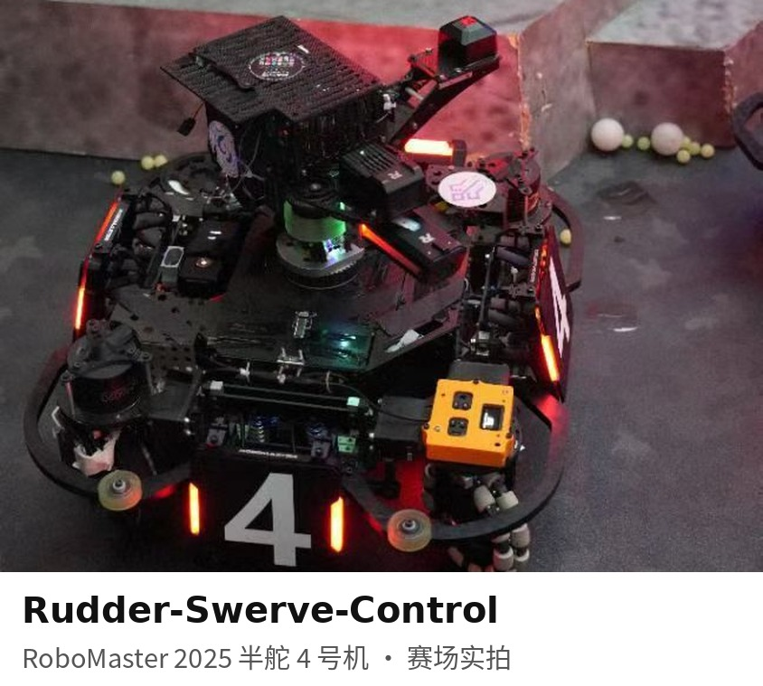
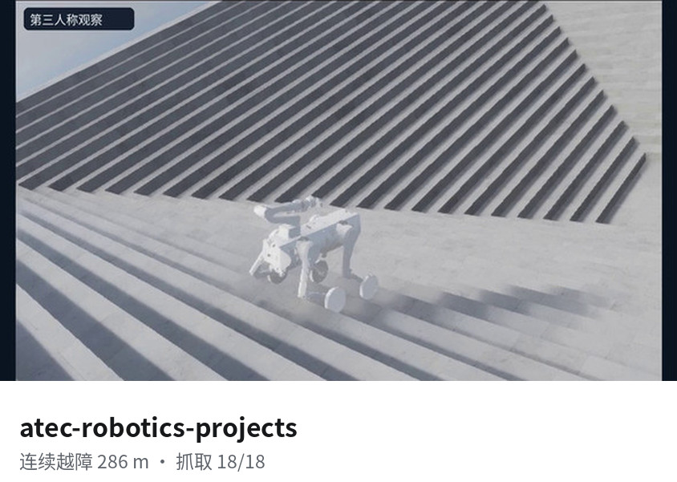
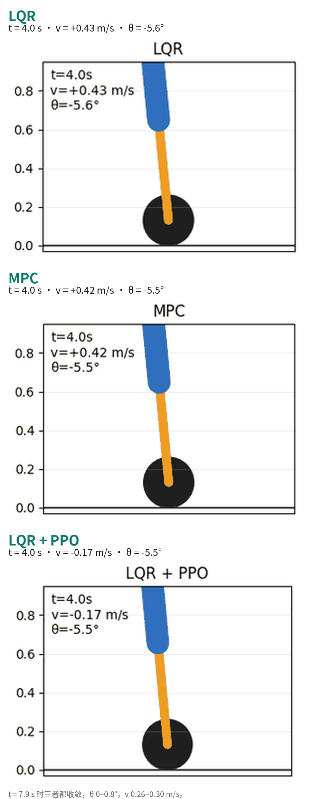

# LYH

**机器人控制与规划** · 从任务规划到执行器实时层 · 实车与整机上可复现

| 286 m | 2 ms | 43,200 次 |
| --- | --- | --- |
| 四足带臂连续越障 | 实车控制周期 | 单线程 ONNX 推理 |

## 精选

<a href="https://github.com/LYHrmer/Rudder-Swerve-Control"><picture><source media="(prefers-color-scheme: dark)" srcset="./assets/card-swerve-v5-dark.jpg"></picture></a>

<a href="https://github.com/LYHrmer/atec-robotics-projects"><picture><source media="(prefers-color-scheme: dark)" srcset="./assets/card-atec-v2-dark.jpg"></picture></a>

### 三种控制器，同场对比

同一扰动、同一机体，LQR / 约束 MPC / LQR + 残差 PPO 并排跑。

[wheel-legged-control-lab](https://github.com/LYHrmer/wheel-legged-control-lab)：D1 轮足整机（23 nq / 16 执行器），VMC 与轮心 Jacobian 负责支撑力分配，三种控制器共用同一个控制循环。留出道路速度误差 **0.0402 → 0.0333 m/s**，6/6 达标。

<picture>
  <source media="(prefers-color-scheme: dark)" srcset="./assets/ctrl-compare-v4-dark.jpg">
  
</picture>

t = 4.0 s 定格：三者 θ 都约 −5.5°，差别在 v——LQR +0.43、MPC +0.42，LQR + PPO 已回到 −0.17 m/s；t = 7.9 s 时三者都收敛。

看动图原版

## 控制栈

**01 轨迹生成与优化 · 0.0333 m/s**

约束 MPC · DLS 解析逆运动学 · 残差策略 PPO · ONNX 实时推理

**02 反馈控制 · −72.5%**

LQR · 滑模 SMC · ESO 扰动观测 · 阻抗 / 导纳 / 力位混合 · VMC

**03 状态估计与辨识 · 6.03 mm**

递推最小二乘 · 编码器与摩擦辨识 · PnP 位姿 · IMU 融合

**04 执行器与实时层 · 2 ms**

GM6020 电流模式 · DM4310 力矩 · 500 Hz 物理步进 · FreeRTOS

**05 感知、导航与仿真 · 286 m**

RGB-D 闭环导航 · 点云聚类抓取 · 连续越障

展开各层仓库与可核验结果

- [wheel-legged-control-lab](https://github.com/LYHrmer/wheel-legged-control-lab) — 速度误差 0.0402 → 0.0333 m/s，6/6 达标
- ddt-d1-rl-lab — PPO → ONNX → 单线程 C++，72 场轨迹与 Python 逐位一致，43,200 次推理 59 s
- [robot-arm-compliant-control-lab](https://github.com/LYHrmer/robot-arm-compliant-control-lab) — Franka 7-DOF，跟踪误差 1.885 → 1.359 mm（24/24）
- [gimbal-lqr-eso](https://github.com/LYHrmer/gimbal-lqr-eso) — DM4310 Pitch 误差降 72.5%
- [gimbal-smc-controller](https://github.com/LYHrmer/gimbal-smc-controller) — 纯 C99，576 组闭环仿真、12 万次 RLS 回归
- custom-6dof-control-lab — 六轴 MuJoCo 模型审计，470 项测试，11/11 工况通过
- robomaster-balance-lab — 平衡底盘 MuJoCo 建模、验证仿真与中文教程
- [robot-vision-control-lab](https://github.com/LYHrmer/robot-vision-control-lab) — PnP 6.03 mm / 1.06°（σ = 1 px、10% 外点），位姿伺服 4.44 s 收敛
- [Rudder-Swerve-Control](https://github.com/LYHrmer/Rudder-Swerve-Control) — STM32F407 + FreeRTOS，2 ms 控制周期，2023–2026 实车
- robomaster-wheelleg-sim2real — 轮足 RL sim2real 工作区：硬件基线、策略契约与训练链路
- [atec-robotics-projects](https://github.com/LYHrmer/atec-robotics-projects) — 连续越障 286 m，调参提速 9.6%，抓取 18/18
- db-lacam-learning — db-LaCAM 中文学习与复盘

未公开的仓库未附链接，可当面演示或给只读权限。

## 工具与技能

给编码代理用的技能包，每个都写了验收条件和什么时候不适用。

- [optimizing-skills-skill](https://github.com/LYHrmer/optimizing-skills-skill) — 用留出验证集改进其它 skill
- [reproducing-papers-skill](https://github.com/LYHrmer/reproducing-papers-skill) — 把论文方法复现进现有代码库
- [deploying-code-skill](https://github.com/LYHrmer/deploying-code-skill) — 部署前先 dry-run，留验证记录和回滚路径
- [web-builder-skill](https://github.com/LYHrmer/web-builder-skill) — 零构建静态站、仪表盘与本地桥接控制台
- [media-scribe](https://github.com/LYHrmer/media-scribe) — 听写匣：浏览器本地音视频转文字，无账号无 API Key

另外 3 个技能包：product-manager-ly-skill、no-ai-flavor-local-skill、webots-gazebo-robot-visualization，以及 research-mentor、web-builder-local 两个私有包

技能包同时用 Claude Code、Codex 与 Cursor 三类代理验证，每次改完跑固定任务集回归。

## 技术栈

- **控制与规划** — 最优 / 鲁棒 / MPC / 滑模 · 力控与柔顺 · 系统辨识 · MAPF · 强化学习
- **语言** — C99 / C11 · Python · C++ · JavaScript
- **仿真与学习** — MuJoCo · Isaac Sim · PyTorch · Stable-Baselines3 · ONNX Runtime
- **嵌入式** — STM32F4 · FreeRTOS · CMSIS-DSP · CAN · DM4310 MIT 模式 · GM6020 电流模式
- **感知与工程** — OpenCV · 相机标定 · PnP · RGB-D · ROS / ROS2 · CMake · pytest · GitHub Actions

## 联系

没公开的项目可以当面演示或给只读权限；公开问题走对应仓库的 Issues。

数字都来自对应仓库的结果文档。2026-11 更新。
