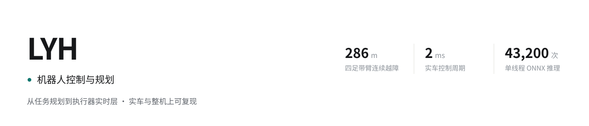
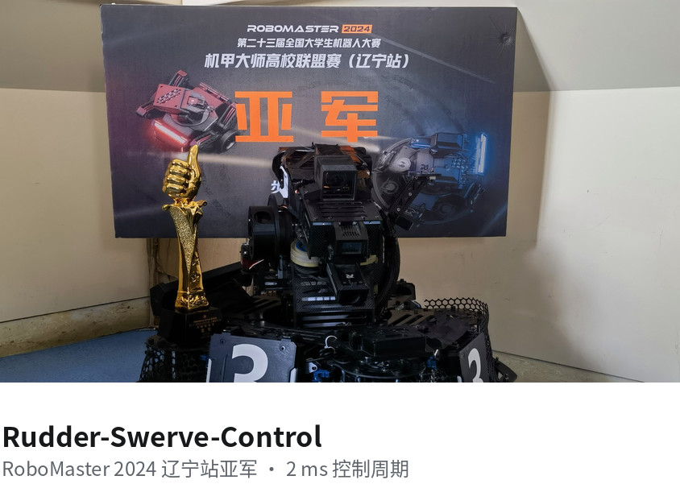
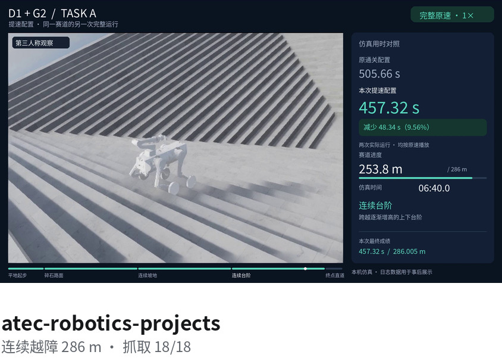
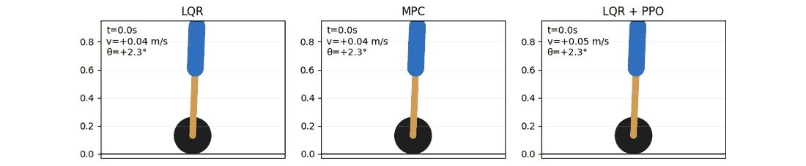

<picture>
  <source media="(prefers-color-scheme: dark)" srcset="./assets/hero-dark.svg">
  
</picture>

## 精选

<a href="https://github.com/LYHrmer/Rudder-Swerve-Control"><picture><source media="(prefers-color-scheme: dark)" srcset="./assets/card-swerve-dark.jpg"></picture></a> <a href="https://github.com/LYHrmer/atec-robotics-projects"><picture><source media="(prefers-color-scheme: dark)" srcset="./assets/card-atec-dark.jpg"></picture></a>

### 三种控制器同场对比

同一扰动、同一机体，LQR / 约束 MPC / LQR + 残差 PPO 并排跑：

[wheel-legged-control-lab](https://github.com/LYHrmer/wheel-legged-control-lab) 把三种控制器放进同一个控制循环：D1 轮足整机（23 nq / 16 执行器），VMC 与轮心 Jacobian 负责支撑力分配。留出道路速度误差 **0.0402 → 0.0333 m/s**，6/6 达标。

## 控制栈

按控制栈从上到下。附链接的是公开仓库，其余未公开、可当面演示。

### 01 · 轨迹生成与优化

- [wheel-legged-control-lab](https://github.com/LYHrmer/wheel-legged-control-lab) — VMC + LQR / 约束 MPC / 残差 PPO 共用控制循环，速度误差 0.0402 → 0.0333 m/s，6/6 达标
- ddt-d1-rl-lab — PPO → ONNX → 单线程 C++ / ONNX Runtime，72 场轨迹与 Python 逐位一致，43,200 次推理 59 s 跑完

### 02 · 反馈控制

- [robot-arm-compliant-control-lab](https://github.com/LYHrmer/robot-arm-compliant-control-lab) — Franka 7-DOF 阻抗 / 导纳 / 力位混合，500 Hz 接触状态机；跟踪误差 1.885 → 1.359 mm（24/24），Python–C++ 对齐 16.8 万周期
- [gimbal-lqr-eso](https://github.com/LYHrmer/gimbal-lqr-eso) — 动力学前馈 + 离散 LQR + ESO，C11 静态状态、不依赖 HAL 与 RTOS；DM4310 Pitch 误差降低 72.5%
- [gimbal-smc-controller](https://github.com/LYHrmer/gimbal-smc-controller) — 线性滑模加可选正则化终端项，纯 C99 无堆分配；576 组模型组合闭环仿真、12 万次 RLS 数值回归
- custom-6dof-control-lab — 六轴 MuJoCo 模型审计与离线控制，470 项测试，33 次固定比较中 11/11 工况通过
- robomaster-balance-lab — 平衡底盘 MuJoCo 建模、验证仿真与中文教程

### 03 · 状态估计与辨识

- [robot-vision-control-lab](https://github.com/LYHrmer/robot-vision-control-lab) — 四路 PnP 方案对比加 body-frame SE(3) 比例控制；PnP 6.03 mm / 1.06°（σ = 1 px、10% 外点），位姿伺服 4.44 s 收敛

### 04 · 执行器与实时层

- [Rudder-Swerve-Control](https://github.com/LYHrmer/Rudder-Swerve-Control) — STM32F407 + FreeRTOS 四舵轮底盘，2 ms 控制周期，GM6020 电流模式与超级电容功率接口，2023–2026 实车
- robomaster-wheelleg-sim2real — 轮足强化学习 sim2real 工作区：硬件基线、策略契约与训练链路
- ddt-d1-rl-lab — 50 Hz 策略 / 250 Hz PD / 500 Hz 物理的双环实时部署

### 05 · 感知、导航与仿真

- [atec-robotics-projects](https://github.com/LYHrmer/atec-robotics-projects) — 四足带臂 RGB-D 闭环导航与抓取；连续越障 286 m，同赛道调参提速 9.6%，抓取 18/18
- db-lacam-learning — db-LaCAM 中文学习与复盘：LIMO 跟踪、实验对比与可运行审计工具

## 工具与技能

给编码代理用的技能包，每个都写了验收条件和什么时候不适用。

- [optimizing-skills-skill](https://github.com/LYHrmer/optimizing-skills-skill) — 用留出验证集改进其它 skill
- [reproducing-papers-skill](https://github.com/LYHrmer/reproducing-papers-skill) — 把论文方法复现进现有代码库
- [deploying-code-skill](https://github.com/LYHrmer/deploying-code-skill) — 部署前先 dry-run，留验证记录和回滚路径
- [web-builder-skill](https://github.com/LYHrmer/web-builder-skill) — 零构建静态站、仪表盘与本地桥接控制台
- [webots-gazebo-robot-visualization](https://github.com/LYHrmer/-webots-gazebo-robot-visualization) — Webots / Gazebo 机器人可视化搭建与调试
- [product-manager-ly-skill](https://github.com/LYHrmer/product-manager-ly-skill) — 产品需求：证据、优先级与红队纪律
- [no-ai-flavor-local-skill](https://github.com/LYHrmer/no-ai-flavor-local-skill) — 中文写作去 AI 腔
- [media-scribe](https://github.com/LYHrmer/media-scribe) — 听写匣：浏览器本地音视频转文字，无账号无 API Key

另有 research-mentor、web-builder-local 两个私有技能包，以及若干技能的本地维护版本

技能包同时用 Claude Code、Codex 与 Cursor 三类代理验证，每次改完跑固定任务集回归。

## 参考与二次开发

fork 来的学习与移植分支。

展开 14 个 fork 仓库

- [Motor-modeling-and-power-control](https://github.com/LYHrmer/Motor-modeling-and-power-control) — 电机功率模型拟合与整车功率控制
- [robowalker_train](https://github.com/LYHrmer/robowalker_train) — RoboMaster 电控培训代码
- [mapf_ros](https://github.com/LYHrmer/mapf_ros) — ROS / ROS2 的多智能体路径规划包
- [sentry_planning](https://github.com/LYHrmer/sentry_planning) — 哨兵自主导航规划参考实现
- [6-Axis-AHRS](https://github.com/LYHrmer/6-Axis-AHRS) — Madgwick 加四元数融合姿态解算
- [Filter_Design](https://github.com/LYHrmer/Filter_Design) — STM32 传统与现代滤波器设计
- [Matrix_and_Robotics_on_STM32](https://github.com/LYHrmer/Matrix_and_Robotics_on_STM32) — 基于 arm_math 的矩阵与机器人学库
- [Wiki](https://github.com/LYHrmer/Wiki) — 电控组技术 Wiki
- [limo_ros](https://github.com/LYHrmer/limo_ros) · [limo-doc](https://github.com/LYHrmer/limo-doc) — LIMO 移动平台 ROS 包与文档
- [RM2024-PowerModule](https://github.com/LYHrmer/RM2024-PowerModule) — 超级电容功率计参考
- [skills](https://github.com/LYHrmer/skills) · [scansci-pdf](https://github.com/LYHrmer/scansci-pdf) · [HowToLiveBetter](https://github.com/LYHrmer/HowToLiveBetter) — 上游技能集、论文扫描与生活指南

## 技术栈

- **控制与规划** — 最优 / 鲁棒 / 模型预测 / 滑模控制 · 力控与柔顺 · 系统辨识 · MAPF · 强化学习
- **语言** — C99 / C11 · Python · C++ · JavaScript
- **仿真与学习** — MuJoCo · Isaac Sim · PyTorch · Stable-Baselines3 · ONNX Runtime
- **嵌入式** — STM32F4 · FreeRTOS · CMSIS-DSP · CAN · DM4310 MIT 模式 · GM6020 电流模式
- **感知与工程** — OpenCV · 相机标定 · PnP · RGB-D · ROS / ROS2 · CMake · pytest · GitHub Actions

## 联系

没公开的项目可以当面演示或给只读权限；公开问题走对应仓库的 Issues。

数字都来自对应仓库的结果文档。2026-11 更新。
